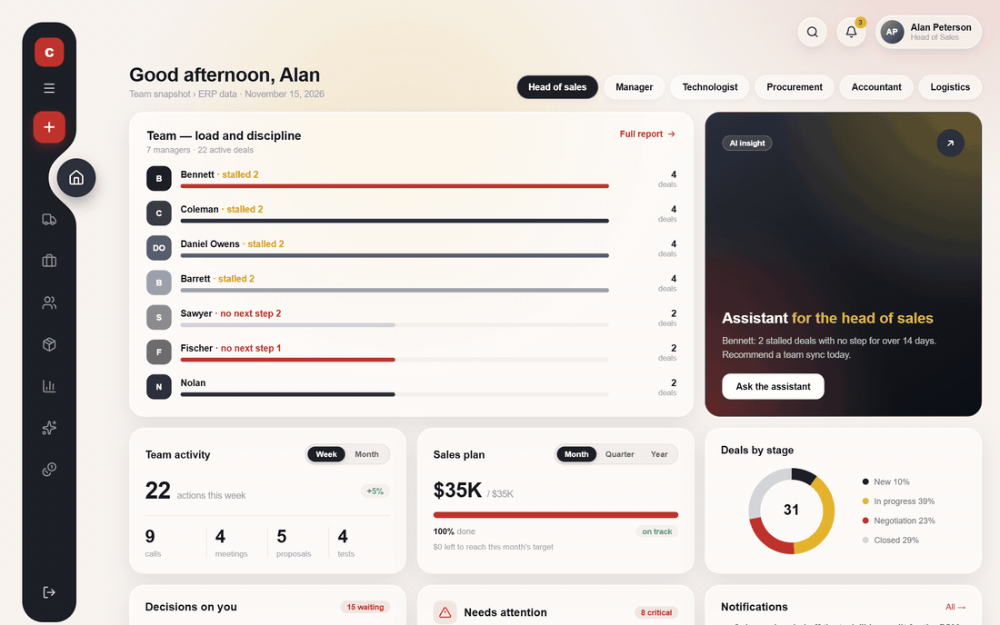
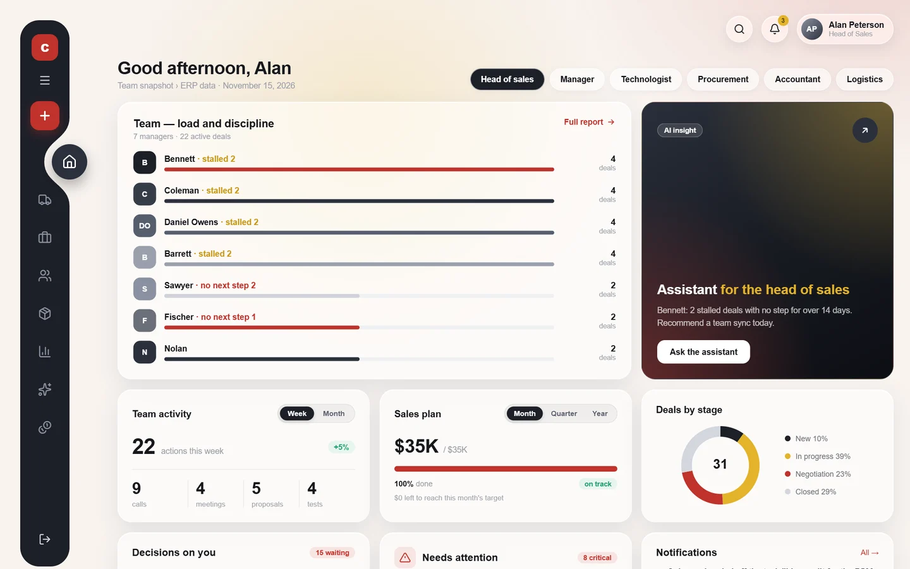
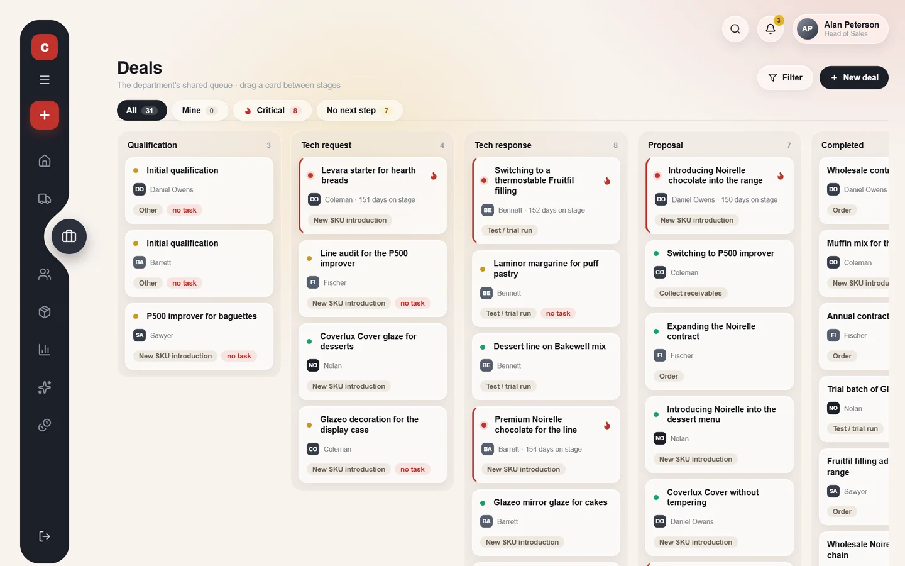
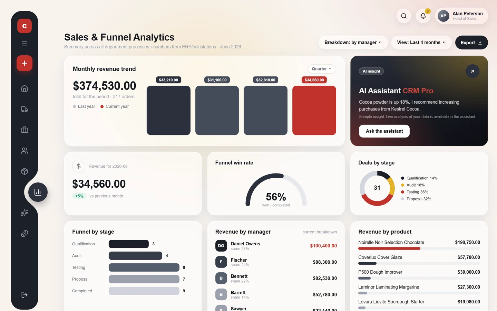

# CRM Pro

A demo CRM for **Millbrook Foods**, a fictional US B2B flour & bakery-ingredients
producer. The company, data, and business docs are synthetic.

**Live demo:** [crm-pro.btwstudio.dev](https://crm-pro.btwstudio.dev)



| Head of sales dashboard                                                       | Deal board                                                | Sales analytics                                                               |
| ----------------------------------------------------------------------------- | --------------------------------------------------------- | ----------------------------------------------------------------------------- |
|  |  |  |

## Demo access

Open `/login` and pick a role card — username and the shared password `demo1234` are
preselected, just hit "Log in".

| Role             | What you see                                       |
| ---------------- | -------------------------------------------------- |
| Head of sales    | whole department, team analytics, the AI assistant |
| Manager          | own deal portfolio + personal analytics            |
| Technologist     | the test/audit queue (no commercial data)          |
| Category manager | quotas, shortages, assortment analytics            |
| Accountant       | the accounting handoff stage (ERP documents)       |
| Logistics        | the loading/dispatch stage                         |

Full feature list (kanban, voice-to-act, AI assistant, ERP integration, ...) →
[docs/FEATURES.md](docs/FEATURES.md).

## Stack

Next.js 16 (App Router) · React 19 · TypeScript (strict) · Prisma 7 + PostgreSQL (or
in-memory, no DB needed for the demo) · Zod 4 · Vitest 4 + Testing Library · Docker
Compose + Caddy for deploy. AI calls go through plain `fetch` — no vendor SDK.

## Architecture

Clean architecture: dependencies point inward, the domain knows nothing about the
framework, ERP, or AI. Swapping an integration (stub → real) happens in one place —
the composition root — without touching any use-case.

```
presentation   Next.js App Router (pages, server actions)
     |         calls use-cases only through the composition root
     v
application   use-cases + PORTS (interfaces, zero I/O)
     |         ErpGateway . LlmProvider . AiGateway . Notifier .
     |         WebSearchGateway . SpeechToText . repositories
     v  depends on
domain         entities + business rules -- no imports from any other layer
     ^  implements the ports
     |
infrastructure adapters, selected by env var:
               ErpGateway  -> StubErpGateway | ODataErpGateway (real/mock OData ERP)
               LlmProvider -> AnthropicLlmProvider | OpenAiLlmProvider
               repos       -> in-memory | Prisma/PostgreSQL
```

The mock ERP (`tools/mock-erp`) is a standalone zero-dependency OData server used to
verify `ODataErpGateway` end-to-end without a real ERP connection.

## 3 hardest problems solved

**1. A serverless-safe PostgreSQL connection.** Next.js dev-mode HMR re-imports
modules on every save, and the `PrismaClient` used to be built without a singleton
guard in production — every request created a fresh connection pool, exhausting
Postgres and throwing `P2037 TooManyConnections`. Fixed with a `globalThis`-cached
singleton behind a lazy `Proxy`: the client (and its DB connection) is only
constructed on first real property access, so importing the module during a static
Next.js build never opens a connection, and every environment (dev HMR, prod, tests)
shares exactly one pool. See `src/infrastructure/persistence/prisma-client.ts`.

**2. Server Actions + Turbopack: `instanceof` lies across bundles.** The login
`redirect()`-on-failure flow (`src/app/login/actions.ts`) needs to catch
`InvalidCredentialsError` and turn it into a soft `redirect("/login?error=1")`
instead of an error overlay. Under Turbopack the `"use server"` bundle and the SSR
bundle can hold _different copies_ of the same class, so a plain `instanceof` check
silently returns `false` in production-like builds. Fixed by matching on
`error.name` as a fallback alongside `instanceof`, and by keeping the success
`redirect()` outside the `try` block (Next's redirect signal is a thrown value —
inside `catch` it would be swallowed as a generic error).

**3. Stopping a trade-secret leak to a global LLM at the payload level, not just
config.** Pricing, margins, and counterparty data may only reach the
data-residency-approved LLM provider; a second, "global" provider (Claude) is
allowed only for anonymized/synthetic prompts. Two guards already existed
(provider-selection config gate + PII pseudonymization) but neither inspected the
actual text about to be sent. Added `ContourGuardLlmProvider`, an `LlmProvider`
decorator that scans the outgoing payload for currency amounts, legal-entity
suffixes, and tax-ID-shaped numbers, and throws _before_ the network call if it
finds one — a false positive blocks the call (fail-safe) rather than risking a
silent leak. See [`docs/adr/0007-llm-data-contour-guardrail.md`](docs/adr/0007-llm-data-contour-guardrail.md).

## How it's verified

`npm run verify` (required before every PR) = **typecheck + lint + format:check +
test**, all currently green:

- **typecheck** — `tsc --noEmit`, strict mode, no unjustified `any`/`as`.
- **lint** — ESLint flat config (`typescript-eslint` recommended +
  `consistent-type-imports` + strict `no-unused-vars`).
- **format:check** — Prettier.
- **test** — Vitest + Testing Library: **1014 tests across 154 files** (49 domain,
  54 application/use-case, 24 infrastructure, 27 presentation/component).

CI adds a production `build`, `commitlint` (Conventional Commits on PRs), and a
conditional `postgres-smoke` job — triggered only when the data layer changes — that
spins up a real Postgres, runs `prisma migrate deploy`, checks schema drift (`prisma
migrate diff --exit-code`, so a schema edit without a migration file fails CI instead
of silently missing production databases), seeds it, and round-trips the Prisma
repositories. `npm run ci:local` mirrors the whole pipeline locally, including a
temporary Docker Postgres. (`.github/workflows/ci.yml` config lands shortly — pending
a token permission grant on this repo; `npm run ci:local` already runs the same checks
today.)

## Getting started

```bash
npm install
cp .env.example .env       # ERP_MODE=stub, AI_MODE=stub by default -- no real ERP or AI needed
npm run dev                # http://localhost:3000
```

## More docs

- [docs/FEATURES.md](docs/FEATURES.md) — full feature list, pages by role, scripts, env vars.
- [docs/adr/](docs/adr) — architecture decision records.
- [docs/DATA_POLICY.md](docs/DATA_POLICY.md) — data-residency and PII rules.
- [docs/LLM_SETUP.md](docs/LLM_SETUP.md) — turning on a real LLM provider.
- [docs/DEPLOY.md](docs/DEPLOY.md) — Docker Compose deploy runbook (demo → pre-prod → prod).
- [CONTRIBUTING.md](CONTRIBUTING.md) — branches, commits, PR workflow.

## License

The code is published for reference. All rights reserved: reading it is welcome, reusing it needs written permission.
